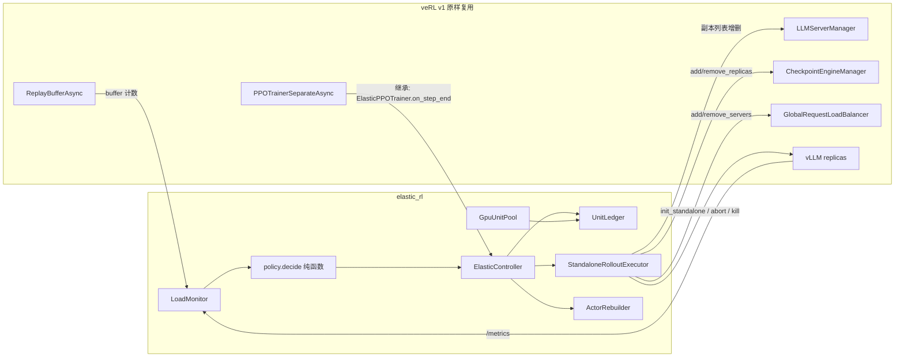
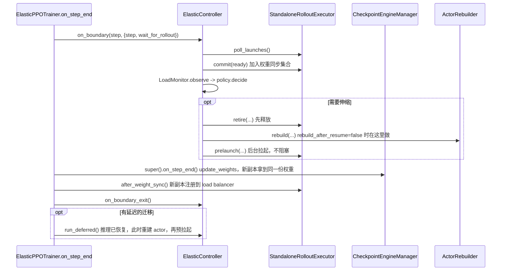

# elastic_rl 设计文档


## 1. 目标

RL 训练里，训练（actor update）和推理（rollout）的负载会随时间变化：response 长度会变，数据分布会变，reward 的延迟也会变。固定的训推 GPU 配比，总有一侧在空等。

elastic_rl 在**不改 veRL 源码**的前提下，于训练运行过程中按两侧的实时负载调整 GPU 分配：

- **推理不够时**：给推理加卡。
- **推理过剩时**：把卡还给空闲池，或借给训练。训练侧伸缩支持 FSDP2 和 Megatron（含 MoE/EP）。

非目标：共置模式的时分复用（`hybrid_rollout.enable_switch`）、PD 分离、critic（GAE）的伸缩。

## 2. 底座：veRL v1 `separate_async`

elastic_rl 建立在 `trainer.v1.trainer_mode=separate_async` 上：

1. actor 占 `global_pool`（`trainer.nnodes × n_gpus_per_node`），推理由独立的 standalone vLLM 副本承担（`rollout.nnodes × n_gpus_per_node`）。“改配比”就是“把节点从一个池挪到另一个池”。
2. 推理通过 TransferQueue 的 replay buffer 异步生产样本，训练每步从 buffer 取 `train_batch_size` 个 prompt group，内部分 `parameter_sync_step` 次 mini-batch 更新（Decoupled PPO 的 π_old 快照在一步内生成和使用）。
3. 每一步结束时 `on_step_end` 做一次 `CheckpointEngineManager.update_weights`：中止推理请求、传权重、恢复生成。所有拓扑变化都放在这个点前后，新加入的副本和老副本拿到同一份权重。

启动时 `validate_elastic_deployment` 检查部署约束，不满足直接报错：

| 约束 | 原因 |
|---|---|
| `trainer.v1.trainer_mode=separate_async`，`hybrid_rollout.enable_switch=False` | 训推分离，训练卡上不跑推理副本 |
| `rollout.name=vllm`，`rollout.nnodes>0`，不开 `disaggregation` | standalone 副本按单元切片拉起 |
| `checkpoint_engine.backend ∈ {nccl, nixl, mooncake}` | 每次同步按当前副本集合重建通信组，支持成员变化 |
| 开 reward model 时必须有独立资源池 | 不能占用弹性单元 |
| 训练伸缩：FSDP2 要求 `strategy=fsdp2`、`fsdp_size=-1` | DCP 按新 world size 重新分片 |
| 训练伸缩：Megatron 要求 distributed optimizer、`dist_ckpt_optim_fully_reshardable=True`、关闭 router replay、checkpoint 内容含 model/optimizer/extra、lr 调度可恢复 | dist-ckpt 跨 DP 规模加载 |
| 训练伸缩：`async_save=False`，无 critic，`state_dir` 不在 `/tmp` 或 `/dev/shm` | 重建前后的所有 rank 要读到同一份完整状态 |

## 3. 总体架构



### 3.1 核心抽象：单元（unit）

- **单元**：默认一个节点（`rollout.n_gpus_per_node` 张卡），对应一个 STRICT_PACK placement group。调度的最小粒度是单元，不会把 TP 或 DP 组切到两个节点上。一个单元内放 `gpus_per_unit / (tp×dp×pp)` 个推理副本。
- **`UnitLedger`**：记录每个单元的角色 `TRAIN` / `ROLLOUT` / `ROLLOUT_PENDING` / `IDLE`。角色迁移必须声明来源状态，对不上就抛错。
- **`GpuUnitPool`**：启动时一次性为所有单元（actor + rollout + spare）预留 placement group。veRL 的 `RayResourcePool` 是懒创建的，所以替换后的 `ResourcePoolManager` 不会重复预留。之后的伸缩只在已预留的单元之间换角色，**运行过程中不再向 Ray 申请或归还 GPU**。
- **spare 单元**：`elastic.spare_units`，启动时空闲，由策略借给需要的一侧。

### 3.2 对 veRL 的接入方式（零源码修改）

| 接入点 | 方式 |
|---|---|
| 入口 | `python -m elastic_rl.main_elastic_ppo`，用 veRL 自带的 `ppo_trainer` Hydra 配置，先做部署校验，再走 `run_ppo` |
| Trainer 类 | `ElasticTaskRunner` 在 `run` 期间把 `verl.trainer.ppo.v1.get_trainer_cls("separate_async")` 换成 `ElasticPPOTrainer`。模式名保持 `separate_async`，因为 `parameter_sync_step` 和 replay buffer 都按模式名读配置 |
| 资源池 | `_init_resource_pool_mgr` 把 `ResourcePoolManager` 包成弹性版本，`global_pool` 由 TRAIN 单元组成 |
| 推理副本放置 | `_setup` 期间把模块里的 `LLMServerManager` 换成子类，每个 ROLLOUT 单元按副本大小切片，每片起一个副本 |
| Actor worker | `make_elastic_actor_worker(DetachActorWorker)` 加两个方法：保存/加载跨规模训练状态（FSDP2 用 DCP，Megatron 用 dist-ckpt） |
| 边界钩子 | 覆盖 `on_step_end`：决策和迁移 → 原有的权重同步 → 新副本接流量 → 延迟的 actor 重建 |
| 指标 | `elastic/*` 合并进 `_pending_sync_metrics`，随每步指标一起输出 |
| 断点续训 | 每次存 checkpoint 时把当前配比写进 `global_step_N/elastic_allocation.json`，续训时按它恢复单元划分 |

## 4. 一个边界上发生什么



关键顺序：

- **先释放，再扩容**：同一次迁移里先下线推理、再改训练、最后预拉起推理，刚释放的单元可以立刻复用。
- **拿到权重后才接流量**：新副本 commit 后进入 `CheckpointEngineManager.replicas`，在紧接着的同步里拿到权重，之后才 `add_servers` 到 load balancer。
- **预拉起异步进行**：拉起 vLLM 要几分钟，副本在后台线程里 `init_standalone`；之后某个边界 `poll_launches` 发现它就绪才 commit。此前单元处于 `ROLLOUT_PENDING`，策略保持 HOLD。
- **重建移出关键路径**（`train.rebuild_after_resume=true`，默认）：actor 重建放到权重同步之后。重建期间推理继续用刚推送的权重生成，重建后的 actor 加载的也正是这份权重，所以 off-policy 程度不变，推理不被阻塞。

## 5. 调度策略（`scaler/policy.py`）

策略是**纯函数** `decide(state, snapshot, allocation, bounds, config) -> (decision, state)`，不依赖 Ray，可以在离线模拟器里回放。

### 5.1 模型

把异步流水线看成两个串联的阶段。设 \(r\) 和 \(t\) 分别为每个单元的推理吞吐和训练吞吐（prompt groups/s），某个配比下的稳态吞吐为

\[
\text{throughput}(R, T) = \min(r \cdot R,\ t \cdot T)
\]

\(r\)、\(t\) 由每一步的测量值做 EMA 平滑得到。buffer 饱和时推理被反压，测到的 \(r\) 只是下界，因此饱和时 \(r\) 只增不减。

### 5.2 决策

1. **保护期**：有副本还在拉起、刚变过拓扑（观测次数不足 `min_observations`）或处在冷却期（`cooldown_steps`）时，一律 HOLD。
2. **GROW**：在 ±`max_units_per_action` 范围内枚举候选配比，预测吞吐至少高 `min_relative_gain`，并且每步节省的时间乘以 `amortize_horizon_steps` 大于等于阻塞成本（训练重建 `train_rebuild_cost_s`，推理成员变化 `rollout_membership_cost_s`）才扩容。训练单元数只取 `batch_plan` 放行的合法值。
3. **PROBE**：buffer 长期饱和（`backpressure_ema ≥ backpressure_high`）、训练几乎不等推理（`wait_ratio ≤ wait_ratio_low`）且 vLLM 没有排队请求时，判定推理过剩。此时 \(r\) 不可信，策略试探性地借一个单元给训练，或只让推理减少一个单元。若随后出现饥饿，GROW 会加回来，并在 `flap_memory_steps` 步内把这个规模作为下限。
4. **RELEASE**：吞吐损失在 `release_tolerance` 以内，就把多出来的推理单元还给空闲池。

### 5.3 信号来源

| 信号 | 来源 |
|---|---|
| 单步时长 | `on_step_begin` 到 `on_step_end`（不含本步权重同步） |
| `wait_for_rollout` | `timing_raw["gen"]`：本步所有 mini-batch 在 `replay_buffer.sample` 上的等待之和 |
| 每单元训练吞吐 | `train_batch_size / (step − wait_for_rollout) / 训练单元数` |
| 每单元推理吞吐 | 两个边界之间新完成的 group 数 / 边界间隔 / 推理单元数。累计完成数 = 已训练的 group + buffer 里已完成或失败的 group |
| buffer 是否饱和 | `get_sampleable_count` 达到闸门 `num_warmup_batches × train_batch_size` 的 95%，或已完成 ≥ 2 个训练 batch |
| 排队请求数、运行请求数、KV 使用率 | 并行抓取每个 vLLM 副本的 `/metrics`（需要 `rollout.disable_log_stats=False`） |

## 6. 推理侧伸缩（`rollout/standalone_rollout.py`）

**扩容**：

1. `prelaunch`：在 IDLE 单元的 placement group 上按副本大小切片，用 veRL 的 `rollout_replica_class` 构造副本（rank 只增不复用），后台线程里 `init_standalone(resource_pool=slice)`。
2. `commit`：等上一次权重同步结束，把副本追加到 `LLMServerManager` 的 `rollout_replicas` / `server_handles` / `server_addresses`，再 `CheckpointEngineManager.add_replicas`。执行器在构造时把 checkpoint manager 的副本列表复制一份，避免它和 server manager 的列表互相别名、被追加两次。
3. `after_weight_sync`：同步完成后 `add_servers` 到全局 load balancer，开始接流量。

**缩容**（`retire`）：

1. 等上一次权重同步结束；不允许下线全部副本。
2. 从 load balancer `remove_servers`，新请求不再路由过去。
3. `abort_all_requests(reject_request=True)`：在途请求被中止，由 agent loop 重试到其他副本，不丢数据。
4. 从 server manager 和 `CheckpointEngineManager.remove_replicas` 中移除。
5. 先 `__ray_terminate__` 优雅退出，最多等 60 s，超时再 `ray.kill`。

预拉起超时（`launch_timeout_s`，默认 900 s）或失败时，单元回到空闲池，不影响训练。

## 7. 训练侧伸缩（`trainer/actor_rebuilder.py`）

`ActorRebuilder.rebuild(unit_ids)`：

1. 保存训练状态到共享目录 `state_dir/step_N_gen_k`，并删除上一份：
   - FSDP2：DCP 保存模型、优化器和 lr scheduler，offload 的状态先临时搬回 GPU；
   - Megatron：`save_checkpoint` 写 dist-ckpt（fully reshardable 的优化器格式）。
2. kill actor 和 ref 的 worker group，等它们真正退出、释放 GPU。
3. 在新的单元集合上建资源池，替换 `global_pool`，按 `PPOTrainer._setup` 的方式重新 spawn actor（和独立的 ref），`init_model`。
4. 加载训练状态（按新的 DP 规模重新分片），再把 `checkpoint_manager` / `standalone_checkpoint_manager` 的 `actor_wg` 指向新 group。
5. 任何一步失败：清掉半成品，按旧单元和最近一次保存的状态重建；这也失败则抛 `RollbackFailedError`。

其他要点：

- **全局 batch 不变**：`batch_plan.feasible_train_unit_counts` 只放行 mini-batch 能被 DP 整除、并满足 Megatron TP/PP/CP/EP 布局（含专家并行对 world size 的整除要求）的单元数。例如 Qwen3-30B-A3B（TP2、EP8、mini-batch 256 行）只放行 1、2、4 个单元。
- **等价性**：`tests/test_fsdp_dcp_equivalence.py` 用真实 torch 多进程验证了 FSDP2 DP 2→4、4→2 前后的 loss 和参数一致（本地无 torch 时跳过）。

## 8. 失败与回滚（`scaler/transaction.py`）

一次迁移是一个 `MigrationTransaction`，每个子步骤登记补偿动作：

| 步骤 | 补偿 |
|---|---|
| retire rollout | 重新预拉起这些单元 |
| resize train | 按旧单元重建 |
| prelaunch rollout | 丢弃拉起，单元回到空闲池 |

任何一步失败，按逆序补偿，记一次 `elastic/scaling_errors`，训练继续；`fail_on_scaling_error=True` 时直接抛错。补偿本身失败抛 `RollbackFailedError`，此时状态不可信，停止训练。

## 9. 配置

见 `elastic_rl/config/elastic.yaml`，通过 `+elastic.<key>=<value>` 覆盖，拼错的键直接报错。常用项：

- `spare_units`：启动时额外预留的空闲单元数。
- `rollout.min_units` / `rollout.max_units`：推理单元上下限。
- `train.enable` / `train.min_units` / `train.max_units` / `train.state_dir`：训练伸缩开关、上下限和状态目录。
- `train.debug_schedule`：实验用，按 `{step: 训练单元数}` 强制重建，不走策略。
- `policy.*`：阈值、冷却和摊销参数。
- `dry_run`：只记录决策，不执行。

## 10. 当前进度

### 10.1 代码

| 内容 | 状态 |
|---|---|
| veRL submodule、入口、部署校验 | 完成，有单测 |
| GpuUnitPool / UnitLedger / 初始配比与续训恢复 | 完成，有单测 |
| standalone 副本预拉起、加入、接流量、下线 | 完成，有单测（mock Ray） |
| FSDP2 DCP / Megatron dist-ckpt 跨规模保存加载、actor 重建 | 完成，有单测；FSDP2 有多进程等价测试 |
| 合法训练规模（FSDP2、Megatron TP/PP/CP/EP） | 完成，有单测 |
| 迁移编排、回滚、重建移出关键路径 | 完成，有单测 |
| 离线模拟器与指标回放 | 完成，有单测 |

本地共 105 个测试通过（1 个需要 torch 的跳过）。依赖 torch/veRL 的模块（`main_elastic_ppo`、`trainer/elastic_trainer.py` 等）本地只做了编译检查。

### 10.2 集群验证计划（`28.49.17.225`，12 × 8 H20）

镜像 `/opt/conda/envs/torch-base`：py3.13、torch 2.10、vLLM 0.20.1、transformers 5.10、megatron-core 0.15、mbridge 0.15、Ray 2.51；TransferQueue 0.1.12 由 `scripts/runtime_env.yaml` 安装。数据为开源 GSM8K（`data/gsm8k/{train,test}.parquet`）。

| 阶段 | 脚本 | 内容 |
|---|---|---|
| 1 | `qwen3_8b_gsm8k_fsdp2.sh MODE=static` | 3 节点（1 训练 + 1 推理 + 1 spare），dry_run，跑通全链路并记录基线 |
| 2 | 同上 `MODE=rollout` | 推理侧伸缩：预拉起、加入同步、接流量、下线 |
| 3 | 同上 `MODE=train_rebuild` | 第 3 步 1→2 个训练单元，第 6 步 2→1，验证 DCP 重建和 loss 连续 |
| 4 | `qwen3_30b_a3b_gsm8k_megatron.sh` | 5 节点起步（2 训练 + 2 推理 + 1 spare），MoE/EP 下的 dist-ckpt 重建（2→1→2）和推理伸缩 |

### 10.3 待确认的风险

- 集群上的 vLLM 内部版本与 veRL `9bdd3713` 的兼容性；Megatron 走 mbridge 加载 Qwen3-MoE。
- Hydra 对 `+elastic.train.debug_schedule={3:2,6:1}` 的整数键解析。
- `runtime_env.yaml` 里 `${LD_LIBRARY_PATH}` 的展开。
- 动态生成的 `ElasticDetachActorWorker` 类能否被 cloudpickle 送到 worker。

## 附：代码地图

```
elastic_rl/
  main_elastic_ppo.py                   入口：部署校验 + 替换 separate_async 的 trainer 类
  config.py, config/elastic.yaml        类型化配置、单元布局和部署校验
  resource/unit_ledger.py               单元角色账本
  resource/gpu_unit_pool.py             每个单元一个 PG，替换 ResourcePoolManager
  rollout/standalone_rollout.py         standalone 副本的拉起、加入、下线和信号采集
  rollout/replica_ops.py                独立事件循环/线程里跑协程等工具函数
  scaler/load.py, load_monitor.py       负载快照
  scaler/policy.py                      纯函数策略
  scaler/controller.py, transaction.py  编排和回滚
  scaler/allocation_store.py            把配比写进 checkpoint，用于断点续训
  trainer/elastic_trainer.py            ElasticPPOTrainer：资源池、副本放置、边界钩子
  trainer/elastic_actor_worker.py       actor worker 扩展方法（DCP / dist-ckpt）
  trainer/actor_rebuilder.py            actor 重建与回滚
  trainer/fsdp_dcp_checkpoint.py        DCP 跨规模保存/加载
  trainer/batch_plan.py                 合法的训练单元数
  sim/simulator.py                      离线策略模拟与指标回放
  examples/                             Qwen3-8B FSDP2 与 Qwen3-30B-A3B Megatron 的 GSM8K 脚本
third_party/verl                        veRL，git submodule
scripts/submit_ray_job.py               提交 Ray 作业（working_dir + veRL py_module）
scripts/runtime_env.yaml                作业 runtime env（TransferQueue、环境变量）
scripts/stage_models.py                 把模型预拷到各节点本地盘
tools/compare_runs.py                   多组实验指标对比
```

